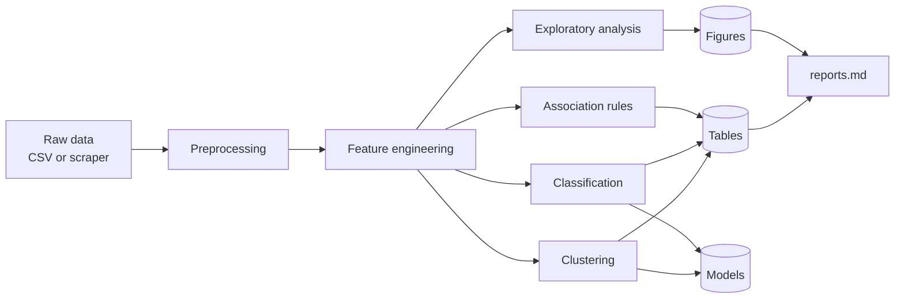

<div dir="rtl">

<h1 align="center">پایپ‌لاین داده‌کاوی کتاب‌ها</h1>

<p align="center">
  یک پایپ‌لاین کامل و ماژولار برای داده‌کاوی محصولات فروشگاهی:<br>
  وب‌اسکرپینگ، پاک‌سازی، مهندسی ویژگی، تحلیل اکتشافی، قواعد انجمنی، دسته‌بندی و خوشه‌بندی.
</p>

<p align="center">
  
  
  
  
  
</p>

---

## فهرست مطالب

- [معرفی](#معرفی)
- [ویژگی‌های کلیدی](#ویژگیهای-کلیدی)
- [جریان کار](#جریان-کار)
- [مجموعه داده](#مجموعه-داده)
- [روش‌شناسی](#روششناسی)
- [ساختار پروژه](#ساختار-پروژه)
- [نصب](#نصب)
- [نحوه استفاده](#نحوه-استفاده)
- [خروجی‌ها](#خروجیها)
- [بازتولیدپذیری](#بازتولیدپذیری)
- [اسکرپ مسئولانه](#اسکرپ-مسئولانه)

---

## معرفی

این پروژه داده خام محصولات یک فروشگاه اینترنتی (در اینجا حدود ۱۰۰۰ عنوان کتاب) را از ابتدا تا انتها تحلیل می‌کند. تمام مراحل از طریق یک نقطه ورود (`main.py`) اجرا می‌شوند و خروجی آن‌ها شامل داده‌های پاک‌سازی‌شده، نمودارها، جدول‌های معیار، مدل‌های ذخیره‌شده و یک گزارش خودکار است.

یک نسخه خام از داده همراه مخزن ارائه شده است؛ بنابراین کل پایپ‌لاین **بدون نیاز به اینترنت** اجرا می‌شود. در صورت نیاز، اسکرپر داخلی می‌تواند داده را دوباره از منبع جمع‌آوری کند.

## ویژگی‌های کلیدی

- **جمع‌آوری داده:** وب‌اسکرپر مؤدب با تأخیر قابل تنظیم بین درخواست‌ها و امکان محدود کردن تعداد صفحات.
- **پیش‌پردازش و مهندسی ویژگی:** پاک‌سازی مقاوم با مقادیر پیش‌فرض برای ستون‌های ناقص، به‌همراه ویژگی‌های مشتق‌شده از قیمت، امتیاز، عنوان و متن.
- **تحلیل اکتشافی:** نمودارهای آماده برای توزیع و رابطه متغیرها.
- **کاوش قواعد انجمنی:** الگوریتم Apriori با معیارهای Support، Confidence و Lift؛ هم به‌صورت پیاده‌سازی دستی و هم با کتابخانه `mlxtend`.
- **دسته‌بندی:** Logistic Regression و Random Forest روی هدف سه‌کلاسه گروه قیمتی.
- **خوشه‌بندی:** KMeans و Agglomerative روی ترکیب TF-IDF و ویژگی‌های عددی، با انتخاب خودکار تعداد خوشه.
- **گزارش‌سازی خودکار:** معیارها، جدول‌ها، نمودارها و گزارش Markdown در هر اجرا بازتولید می‌شوند.
- **قطعیت در نتایج:** Random State ثابت و مدیریت متمرکز مسیرها.

## جریان کار



## مجموعه داده

| | |
|---|---|
| **حوزه** | محصولات فروشگاهی |
| **نوع محصول** | کتاب |
| **منبع** | [Books to Scrape](https://books.toscrape.com/) (سایت عمومی و آزمایشی که برای تمرین اسکرپینگ ساخته شده است) |
| **حجم** | حدود ۱۰۰۰ محصول (نسخه همراه پروژه: ۹۹۳ رکورد) |
| **نسخه همراه** | `data/raw/books_seed.csv` |
| **صفحه نمونه** | `data/raw/sample_catalogue_page.html` |

ورودی سفارشی هم پشتیبانی می‌شود. فایل CSV حداقل باید ستون‌های `title` و `price` را داشته باشد و ستون‌های دیگر در مرحله پیش‌پردازش با مقدار پیش‌فرض مدیریت می‌شوند.

## روش‌شناسی

### قواعد انجمنی

برای هر کتاب یک Basket از ویژگی‌های دسته‌ای ساخته می‌شود:

- گروه قیمت
- امتیاز و گروه امتیاز
- طول عنوان
- موضوع متن
- وجود شماره سری
- گروه حرف اول

سپس Apriori اجرا شده و قواعد با سه معیار **Support**، **Confidence** و **Lift** ارزیابی می‌شوند. موتور پیش‌فرض، پیاده‌سازی دستی (`apriori_manual.py`) است و با گزینه `--association-engine mlxtend` می‌توان نسخه کتابخانه‌ای را اجرا کرد.

### دسته‌بندی

- **برچسب هدف:** `price_band` با سه کلاس `Low`، `Medium` و `High`
- **تقسیم داده:** Stratified Train/Test Split
- **مدل‌ها:** Logistic Regression و Random Forest
- **معیارها:** Accuracy به‌همراه Precision، Recall و F1 به‌صورت Macro
- **خروجی‌ها:** ماتریس درهم‌ریختگی هر مدل و مدل‌های سریالایز‌شده

### خوشه‌بندی

1. ترکیب ویژگی‌های متنی **TF-IDF** با ویژگی‌های عددی استانداردشده
2. کاهش بعد با **Truncated SVD**
3. انتخاب تعداد خوشه با **Silhouette Score** برای `k` از ۲ تا ۶
4. اجرای **KMeans** و **Agglomerative Clustering**
5. استخراج پروفایل هر خوشه برای تفسیر نتایج

## ساختار پروژه

```text
books_data_mining_project/
├── data/
│   ├── raw/                       # داده خام و نسخه همراه پروژه
│   ├── interim/                   # داده پاک‌سازی‌شده
│   └── processed/                 # داده همراه با ویژگی‌ها
├── models/                        # مدل‌های ذخیره‌شده (.joblib)
├── notebooks/
│   └── complete_analysis.ipynb    # تحلیل کامل در نوت‌بوک
├── reports/
│   ├── figures/                   # نمودارهای تولیدشده
│   └── tables/                    # جدول‌های معیار و قواعد
├── src/
│   ├── config.py                  # مسیرها و تنظیمات مرکزی
│   ├── data_loader.py             # بارگذاری داده
│   ├── web_scraper.py             # اسکرپر
│   ├── preprocessing.py           # پاک‌سازی
│   ├── feature_engineering.py     # مهندسی ویژگی
│   ├── exploratory_analysis.py    # تحلیل اکتشافی
│   ├── transaction_builder.py     # ساخت Basket
│   ├── apriori_manual.py          # Apriori دستی
│   ├── apriori_library.py         # Apriori با mlxtend
│   ├── association_rules_analysis.py
│   ├── classification.py
│   ├── clustering.py
│   ├── visualization.py
│   ├── report_builder.py          # تولید reports.md
│   ├── pipeline.py                # هماهنگی همه مراحل
│   └── utils.py
├── main.py                        # نقطه ورود (CLI)
├── overview.md                    # مرور کلی پروژه
├── reports.md                     # گزارش تولیدشده
└── requirements.txt
```

## نصب

**پیش‌نیازها:** Python 3 و `pip`

### Linux / macOS

```bash
cd books_data_mining_project
python3 -m venv venv
source venv/bin/activate
python3 -m pip install -r requirements.txt
```

### Windows (PowerShell)

```powershell
cd books_data_mining_project
python -m venv venv
venv\Scripts\Activate.ps1
python -m pip install -r requirements.txt
```

## نحوه استفاده

اجرای کامل پایپ‌لاین روی داده همراه پروژه:

```bash
python3 main.py
```

جمع‌آوری مجدد داده از وب و سپس اجرای همه مراحل:

```bash
python3 main.py --scrape
```

### راهنمای گزینه‌های CLI

| گزینه | توضیح | مثال |
|---|---|---|
| *(بدون گزینه)* | اجرای کامل روی نسخه همراه پروژه | `python3 main.py` |
| `--scrape` | جمع‌آوری داده زنده پیش از تحلیل | `python3 main.py --scrape` |
| `--max-pages N` | محدود کردن تعداد صفحات فهرست (تست سریع) | `python3 main.py --scrape --max-pages 2` |
| `--delay S` | مکث بین درخواست‌ها به ثانیه | `python3 main.py --scrape --delay 0.8` |
| `--association-engine mlxtend` | استفاده از `mlxtend` به‌جای Apriori دستی | `python3 main.py --association-engine mlxtend` |
| `--input PATH` | استفاده از فایل CSV دلخواه | `python3 main.py --input path/to/input.csv` |

## خروجی‌ها

| دسته | فایل‌ها |
|---|---|
| **داده‌ها** | `data/interim/books_cleaned.csv`، `data/processed/books_features.csv` |
| **نمودارها** | `reports/figures/price_distribution.png`، `rating_counts.png`، `price_by_rating.png` |
| **قواعد انجمنی** | `reports/tables/association_rules.csv` |
| **دسته‌بندی** | `reports/tables/classification_metrics.csv`، `confusion_matrix_logistic_regression.csv`، `confusion_matrix_random_forest.csv` |
| **خوشه‌بندی** | `reports/tables/k_selection_scores.csv`، `clustering_metrics.csv`، `cluster_profiles_kmeans.csv`، `cluster_profiles_agglomerative.csv` |
| **مدل‌ها** | `models/logistic_regression.joblib`، `random_forest.joblib`، `kmeans.joblib` |
| **گزارش** | `reports.md` |

## بازتولیدپذیری

- مقدار `random_state` در همه مراحل تصادفی برابر `42` است.
- همه مسیرها یک‌بار در `src/config.py` تعریف شده‌اند.
- اجرای پیش‌فرض کاملاً آفلاین است و فقط `--scrape` به اینترنت نیاز دارد.
- داده خام همراه مخزن نگهداری می‌شود، پس نتایج روی هر سیستمی قابل تکرار است.

## اسکرپ مسئولانه

منبع داده یک سایت آزمایشی است که برای تمرین اسکرپینگ ساخته شده است. اسکرپر بین درخواست‌ها مکث می‌کند تا فشاری به سرور وارد نشود؛ لطفاً مقدار `--delay` را در حد معقول نگه دارید. اگر اسکرپر را برای سایت دیگری تغییر می‌دهید، پیش‌تر شرایط استفاده و فایل `robots.txt` آن را بررسی کنید.

</div>
